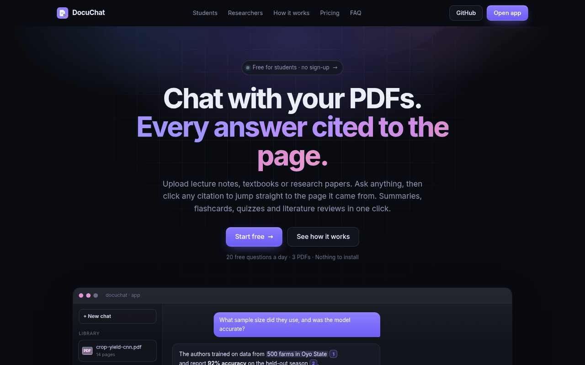
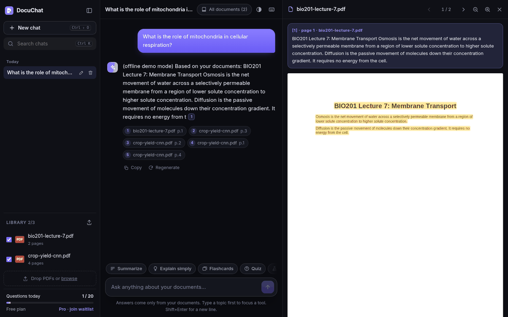
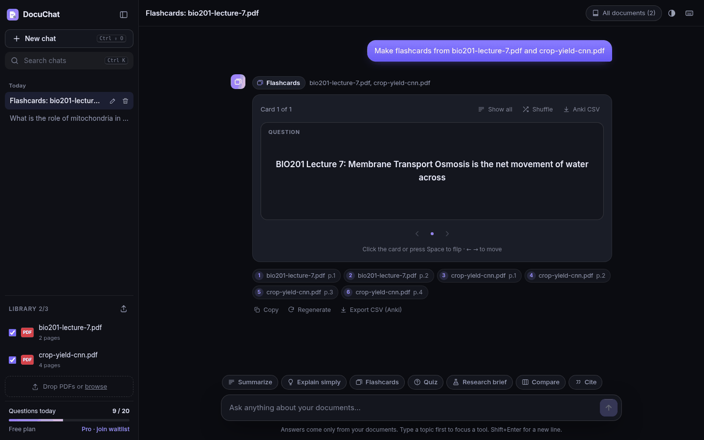
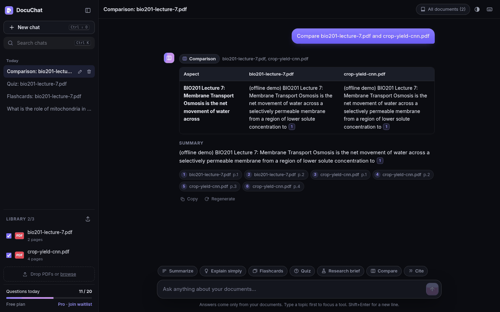
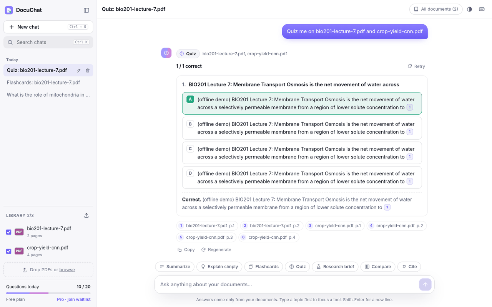
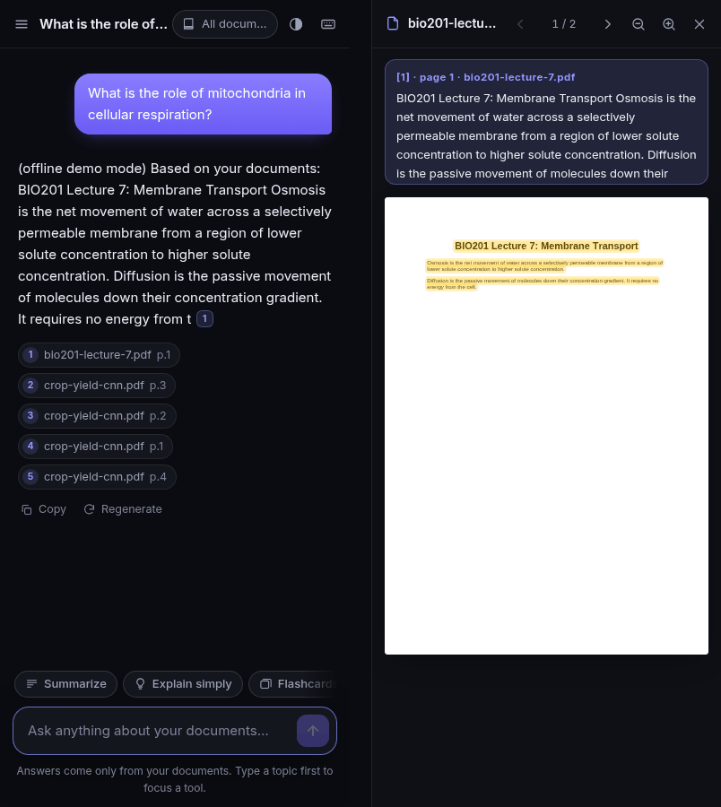

# DocuChat: chat with your PDFs, every answer cited to the page

Upload lecture notes, a textbook chapter or a stack of research papers, ask anything, and get an answer where **every claim links to the exact page it came from**. Click a citation and the PDF opens beside the chat on that page, with the passage highlighted. If the answer isn't in your documents, DocuChat says so instead of guessing.

One click also turns a document into a summary, flashcards, a quiz, a research brief, a side-by-side comparison or a ready-to-paste citation.

**Exam Prep** turns your own notes into a practice exam: objective or theory, university or WAEC/JAMB, timed or untimed, marked instantly with the page to revise.

**Live:** [docuchat-7jap.onrender.com](https://docuchat-7jap.onrender.com) · **App:** [docuchat-7jap.onrender.com/app](https://docuchat-7jap.onrender.com/app) · **Exam Prep:** [docuchat-7jap.onrender.com/exam](https://docuchat-7jap.onrender.com/exam)
Free, no sign-up. The free Render instance sleeps when idle, so the first load can take about 30 seconds.

Built by **Musendiq Oladimeji** (Altix Africa).



---

## Who it's for

**Students**
- Turn a 60-page reading into exam-ready material: TL;DR plus key points, plain-language explanations, flip-card flashcards (Anki CSV export) and multiple-choice quizzes with explanations.
- Every fact traces back to your course material, so you can check it before you rely on it.
- **Exam Prep** (`/exam`): practice exam questions from your own notes so you walk in confident. Pick a PDF and page range, objective (MCQ), theory or mixed, 5 to 50 questions, a style (University, WAEC, JAMB/UTME, General) and a difficulty, timed or untimed.

**Researchers**
- Ask across several papers at once. Answers are drawn only from the retrieved passages.
- Research briefs pull out the question, methodology, findings, limitations and future work.
- Compare papers in a side-by-side table of aims, methods, data, results and limitations.
- Citation export in APA 7, MLA 9 and BibTeX, built from the title page and PDF metadata, editable before you copy.

## Features

| | |
|---|---|
| **Cited answers** | Streamed answers with numbered `[n]` chips that point to a file and page. A relevance floor makes it refuse off-topic questions. Follow-up questions keep the last few turns as context. |
| **Built-in PDF viewer** | pdf.js renders the cited page beside the chat, highlights the cited passage and shows the snippet. Has page navigation and zoom. |
| **Study & research tools** | Summarize · Explain simply · Flashcards · Quiz · Research brief · Compare · Cite. Type a topic first to focus a tool. |
| **History in your browser** | Chats, PDFs, chunks and vectors are kept in IndexedDB, so nothing is stored on the server long-term. Search, rename and delete chats. |
| **Survives restarts** | If the server restarts and forgets your documents, the browser silently re-uploads its saved index. No re-embedding and no quota used. |
| **Exam Prep** | Exam-style question sets from a page range of one PDF. Timer that auto-submits, question navigator, one-at-a-time or all-on-one-page, flag for review. Instant MCQ feedback with an explanation and "see page X"; theory answers marked by the AI point by point against a marking scheme, with partial credit and a model answer. Results show score, time, breakdown by topic and page, weak areas, "Retry wrong questions" and "Generate new set on weak areas". Progress history and the in-progress attempt are kept in the browser. |
| **Polish** | Markdown and KaTeX math, drag-and-drop upload with progress, dark/light/auto theme, keyboard shortcuts (`?`), mobile layout, strict CSP. |

<p>
  
  
</p>

## Architecture

```
Browser (static/app.*)                              FastAPI (app/)
┌─────────────────────────────┐   upload PDF   ┌──────────────────────────────────────────┐
│ IndexedDB                   │ ─────────────► │ pypdf per page → chunker (900/150 chars)  │
│  docs:  PDF blob, chunks,   │ ◄───────────── │ → Gemini embeddings (768-d)               │
│         float16 vectors     │  chunks+vectors│ → in-memory VectorStore per workspace     │
│  convs: chats & tool output │                │                                          │
│                             │  question      │ embed query → top-k cosine (+ min score)  │
│ pdf.js viewer, KaTeX,       │ ─────────────► │ → prompt with numbered sources            │
│ marked + DOMPurify          │ ◄── NDJSON ─── │ → Gemini answer, streamed                 │
│                             │  409 missing?  │                                          │
│ restore from IndexedDB  ────┼──────────────► │ POST /api/documents/restore (no re-embed) │
└─────────────────────────────┘                └──────────────────────────────────────────┘
```

- **No database.** Each visitor gets an anonymous workspace (HttpOnly cookie) held in server memory, with LRU and idle eviction to keep RAM bounded on a 512 MB instance. Quotas are counted per workspace and per IP.
- **The browser holds the durable copy.** The upload response includes the chunks and normalised float16 vectors (about 2 KB per chunk), which the browser keeps in IndexedDB with the original PDF.
- **Restore protocol.** When the server has lost a document (for example after a free-tier restart), any chat or tool call returns `409 {"code": "missing_documents", "missing": [...]}`. The browser posts each missing document to `/api/documents/restore` and retries once. After a few minutes idle, the browser re-syncs before the next question, so the 409 round trip is usually skipped.
- **Providers.** Gemini (`gemini-2.5-flash-lite` chat, `gemini-embedding-001` at 768 dims) by default. OpenAI and a deterministic offline `fake` provider sit behind the same interface.

| Module | Role |
|---|---|
| `app/main.py` | FastAPI routes, workspaces, quotas, security headers, static pages |
| `app/ingest.py` | PDF text and metadata extraction, page-aware chunking |
| `app/store.py` | Thread-safe in-memory vector store |
| `app/rag.py` | Retrieval, prompt construction, citations, history trimming |
| `app/tools.py` | Study and research tools: prompts, JSON validation, citation formatting |
| `app/exam.py` | Exam Prep: page-range context, batched question generation with strict validation, MCQ and theory marking |
| `app/providers.py` | Gemini, OpenAI and offline fake providers |
| `app/workspaces.py` | Per-visitor workspaces and daily quotas |
| `static/` | Landing page (`/`), the app (`/app`) and Exam Prep (`/exam`): vanilla JS, no build step |

<p>
  
  
</p>

## API

| Method | Path | Description |
|---|---|---|
| `GET` | `/api/health` | Liveness: `{status, provider, version}` |
| `GET` | `/api/config` | Limits, max upload size, tool list, provider |
| `GET` | `/api/usage` | Questions used/limit and documents used/limit for this workspace |
| `POST` | `/api/documents` | Upload a PDF (multipart `file`). Returns id, pages, metadata and the `index` (chunks + base64 float16 vectors) for the browser to keep |
| `GET` | `/api/documents` | Documents in this workspace |
| `DELETE` | `/api/documents/{id}` | Remove a document |
| `POST` | `/api/documents/restore` | Re-hydrate a document from the browser's copy: `{id, filename, pages, meta, dim, dtype, chunks, vectors}`. Free, idempotent |
| `POST` | `/api/chat` | `{question, doc_ids?, history?}`. Streams NDJSON: one `sources` event, `token` events, then `done` (or `error`) |
| `POST` | `/api/tools/{tool}` | `tool` = `summarize`, `explain`, `flashcards`, `quiz`, `brief`, `compare` or `cite`. Body `{doc_ids, topic?, count?, difficulty?}`. Returns `{tool, title, data, markdown, sources, usage, cost}` |
| `POST` | `/api/exam/generate` | `{doc_id, page_from?, page_to?, qtype: mcq\|theory\|mixed, count: 5-50, theory_count?, difficulty, style: university\|waec\|jamb\|general, topic?}`. Returns `{doc_id, filename, settings, questions, total_marks, usage}`. MCQs carry `options`, `answer`, `explanation`, `pages`; theory questions carry `parts`, `marks`, `marking_points`, `model_answer`, `pages`. One exam set from the daily exam limit |
| `POST` | `/api/exam/mark` | `{style, items: [{id, question, choice? \| answer?}]}`. MCQs are checked with no AI call; up to 10 theory answers are marked per request against their marking points. Returns `{results, usage}` |

Error codes: `400` bad input · `402` document limit · `409` documents need restoring · `413` too large · `422` unreadable or scanned PDF · `429` daily limit · `502`/`503` AI service problem (the question is refunded).

Quick check with the offline provider:
```bash
LLM_PROVIDER=fake uvicorn app.main:app --port 8000 &
curl -s localhost:8000/api/health
curl -s -c jar -b jar -F file=@paper.pdf localhost:8000/api/documents | jq '{id, pages, chunks}'
curl -s -b jar -H 'content-type: application/json' -d '{"question":"What is the main finding?"}' localhost:8000/api/chat
```

## Run locally

```bash
git clone https://github.com/babypython505-byte/DocuChat.git && cd DocuChat
python -m venv .venv && source .venv/bin/activate
pip install -r requirements.txt
cp .env.example .env              # add a free Gemini key from https://aistudio.google.com/apikey
set -a && . ./.env && set +a
uvicorn app.main:app --reload     # http://localhost:8000 (landing) and http://localhost:8000/app
```
No key? `LLM_PROVIDER=fake uvicorn app.main:app` runs the whole flow offline. Answers are extracts rather than AI-written.

Docker:
```bash
docker build -t docuchat . && docker run -p 8000:8000 -e GEMINI_API_KEY=... docuchat
```

Tests:
```bash
pip install -r requirements-dev.txt && pytest -q
```

## Environment variables

| Variable | Default | Purpose |
|---|---|---|
| `GEMINI_API_KEY` | (none) | Enables the Gemini provider (recommended, free tier) |
| `OPENAI_API_KEY` | (none) | Enables the OpenAI provider if no Gemini key is set |
| `LLM_PROVIDER` | `gemini` if a Gemini key is set, else `openai` if an OpenAI key is set, else `fake` | Force `gemini`, `openai` or `fake` |
| `GEMINI_CHAT_MODEL` | `gemini-2.5-flash-lite` | Chat model, with built-in fallbacks |
| `GEMINI_EMBED_MODEL` | `gemini-embedding-001` | Embedding model (768 dims) |
| `CHAT_MODEL` / `EMBED_MODEL` | `gpt-4o-mini` / `text-embedding-3-small` | OpenAI models |
| `FREE_QUESTIONS_PER_DAY` | `20` | Questions and tool runs per workspace and per IP per day |
| `FREE_DOCS_PER_WORKSPACE` | `3` | PDFs held at once |
| `FREE_EXAM_SETS_PER_DAY` | `5` | Exam sets generated per workspace and per IP per day |
| `FREE_EXAM_MARKS_PER_DAY` | `40` | Theory-marking requests per day (MCQ marking is free) |
| `MAX_UPLOAD_MB` | `20` | Upload size limit |
| `MAX_CHUNKS_PER_DOC` | `1200` | About 400 pages; caps RAM per document |
| `CHUNK_SIZE` / `CHUNK_OVERLAP` | `900` / `150` | Chunking, in characters |
| `TOP_K` / `MIN_SCORE` | `5` / `0.2` | Retrieval depth and relevance floor |

## Deploy on Render (free tier)

1. Fork the repo and create a **Blueprint** on [render.com](https://render.com) from it. `render.yaml` sets up a free Python web service with `uvicorn app.main:app --host 0.0.0.0 --port $PORT` and a `/api/health` health check.
2. Set `GEMINI_API_KEY` in the service's environment (it is marked `sync: false`, so it never lives in the repo).
3. Optional: `.github/workflows/keepalive.yml` pings `/api/health` every 10 minutes to cut down cold starts. Free instances sleep after 15 idle minutes.

Free instances lose memory on every restart or sleep. That is expected: browsers restore their documents through `/api/documents/restore` on their next request.

## Limits (free plan)

- **20 questions a day**. A tool run counts as one question, and Research brief and Cite count one per selected document. Limits are counted per workspace and per IP and reset daily (UTC).
- **5 exam sets a day** and **40 theory-marking requests a day** in Exam Prep (separate from questions). Retrying wrong questions reuses the set, so it costs nothing.
- **3 PDFs** in the library at a time, up to 20 MB and about 400 pages each.
- Text-based PDFs only: scanned PDFs need OCR first.
- History lives in the browser that created it. Clearing site data or switching devices starts fresh.



## Roadmap

- Accounts with synced history (Postgres + pgvector), and a Pro tier with higher limits
- OCR for scanned PDFs; DOCX and slide decks
- Hybrid search (BM25 + vectors) with a reranker
- Evaluation harness for answer faithfulness and retrieval recall

## Hire me

I build AI chatbots, agents and automations for startups and businesses, on your documents, your CRM or your WhatsApp.
**Email:** babypython505@gmail.com · **Contra:** [contra.com/baby_python_0d8w5tci](https://contra.com/baby_python_0d8w5tci)

MIT License
